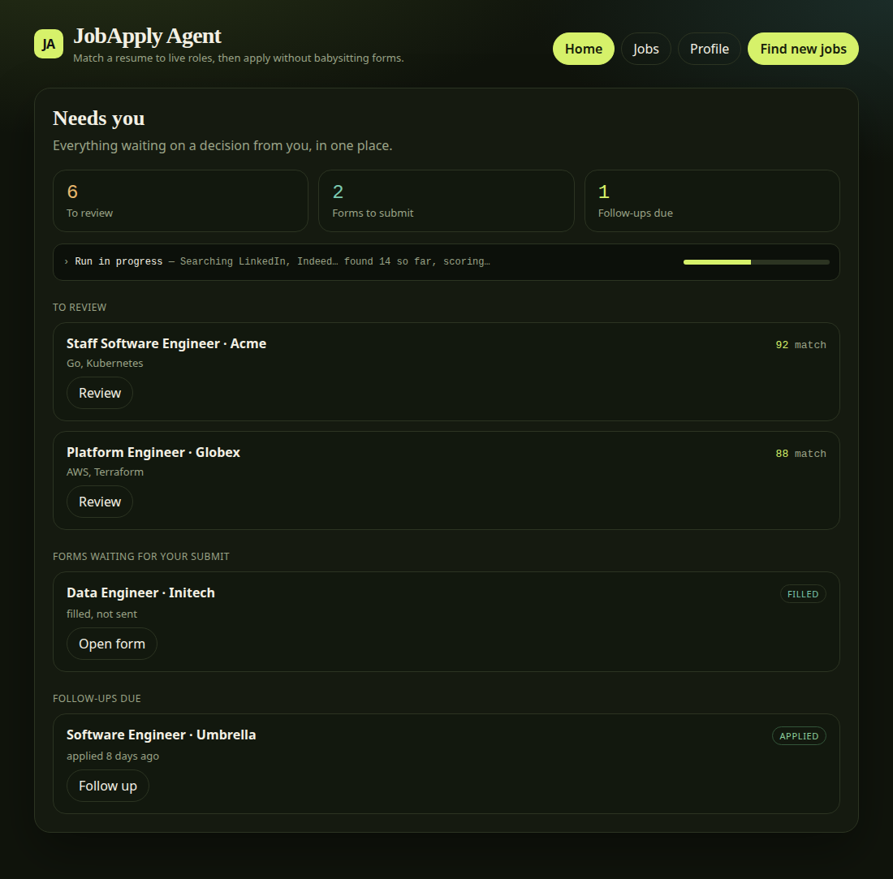
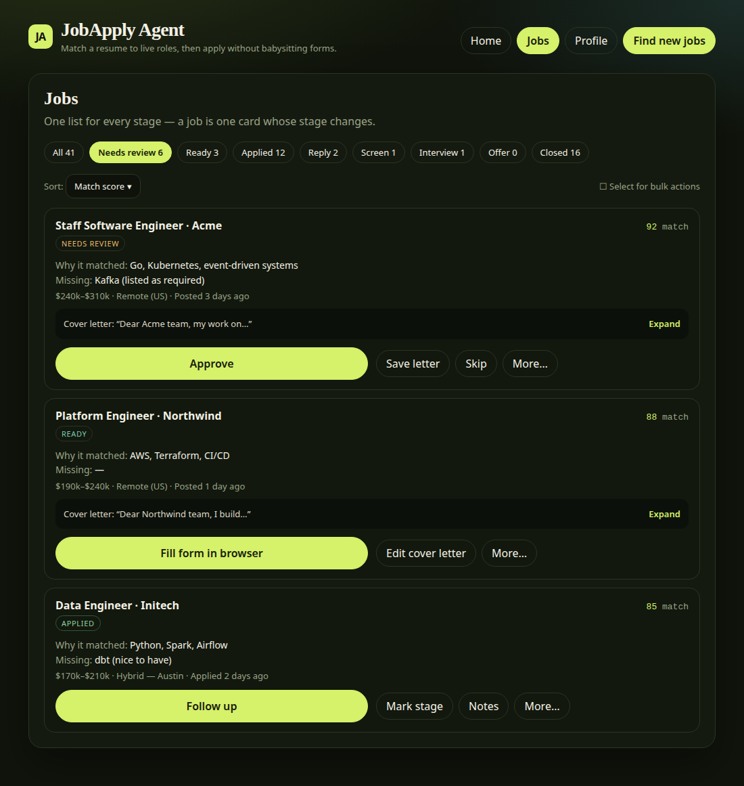
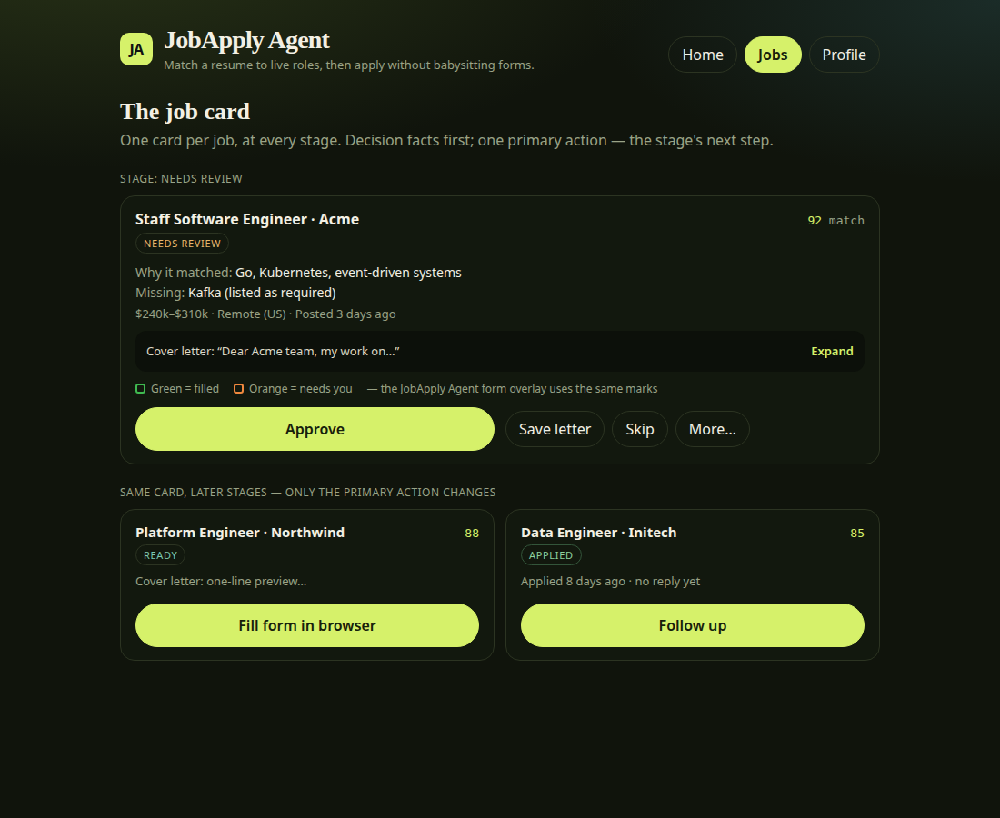
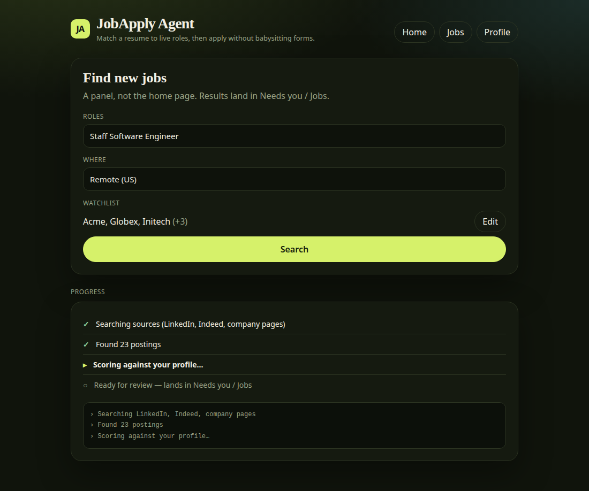
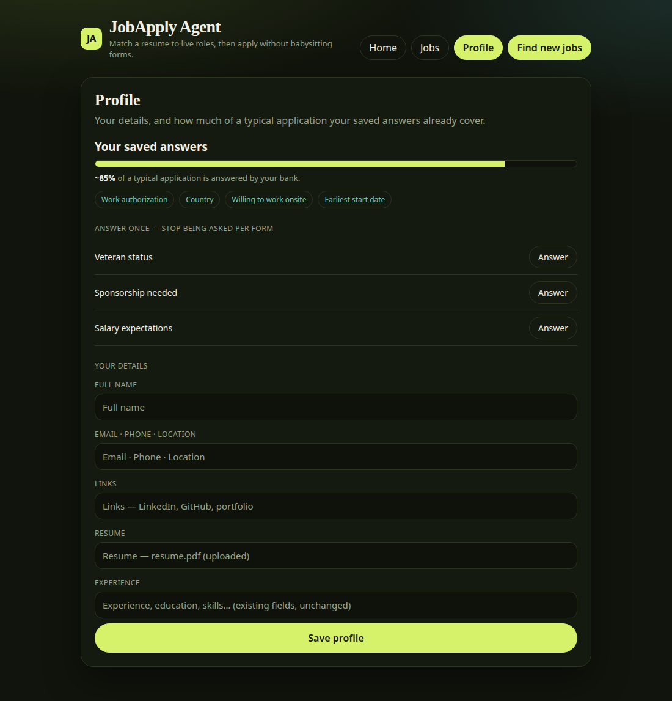

# Proposal: Organize the UI Around the Job Pipeline, Not the System Pipeline

- Status: Proposed
- Date: 2026-11-14
- Deciders: Pratik Singh (Bhanu Sreekar Reddy, repo owner, to review)

## Context

The app's navigation mirrors how the system is built, not what the user is doing. The tabs are Run, Tracker, and Companies: run the agent, review what it produced, then track outcomes in a second place. But the user has one job throughout — moving a job from *found* to *applied* to *interview* — and the same job appears as different cards in different places as it moves: a search result, a review packet, a tracker row. Each place has its own card, its own buttons, and its own idea of the job's state.

This is not hypothetical. Two symptoms surfaced in real use on 2026-11-14:

- Approving a job in the review list teleported the user into the Applications tab and opened the form (the auto-navigation shipped in the improvement-notes round). The fix in PR #16 keeps the user in place — but it treats the symptom. The jump was only possible because "review" and "applications" are separate rooms for one continuous list.
- The review queue lists only pending-review applications, so an approved job vanished from the list the moment it was approved; PR #16 additionally had to pin approved cards into the queue so users could keep working with them. A list that drops the item you just acted on is a sign the list boundaries are drawn in the wrong place.

The proposals below are presentation and information-architecture changes. They are independent — accepting one does not require accepting the rest — and the phasing at the end orders them by cost.

## Proposal 1 — One pipeline, one list

Merge run results, the review queue, and the tracker into a single Jobs list. A job is one card whose stage changes: New match → Needs review → Ready → Applied → Recruiter reply → Screen → Interview → Offer → Closed. The tabs become stage filters with counts ("Needs review (6)", "Applied (12)") over that one list.

A job can never "go" anywhere else, because there is nowhere else. The stage model already exists — the tracker computes pipeline stages today (including the "Not applied" default and the rule that a stage advances only on a real submission) — this proposal points the whole UI at it instead of only the tracker tab.

## Proposal 2 — A "Needs you" inbox as the home view

The product's core loop is queuing human decisions. The home view should open on those queues, with counts:

- Jobs awaiting review.
- Filled forms awaiting the user's submit click (pre-fill never submits — the user does).
- Follow-ups due (the tracker already computes a 7-day follow-up nudge for applied jobs).

Running a search becomes a "Find new jobs" action that feeds the inbox, not the home page itself. Today the app opens on the run form — the machine's starting point, not the user's.

## Proposal 3 — Five-second triage cards

Real usage is batch review: scanning a list and deciding approve or skip per job in seconds. The card should lead with what decides that:

- Match score, and why it matched (top matching skills).
- What's missing (gaps against the posting).
- Salary and location where known, and the posting's age.

The cover letter collapses to a one-line preview (partly true today — approval already collapses it). Add keyboard triage (A approve / S skip / arrow keys to move) and bulk actions (approve everything above a chosen score, skip everything below one) so a batch of twenty jobs is a keyboard pass, not twenty mouse trips.

## Proposal 4 — One primary action per stage

A card's buttons today are a flat row of equals: Approve, Save letter, Skip — then, after approval, Fill form in browser, Mark submitted, Edit cover letter. Every button looks equally important, so the user re-derives "what do I do next with this one?" on every card.

Make the stage's next action the one primary button (Approve on a pending job, Fill form in browser on a ready one, Mark submitted after filling), and demote the rest to a quieter secondary row or an overflow menu. The set of available actions does not change — their hierarchy does.

## Proposal 5 — User language, not system language

Rename to the words users think in: Run → **Find jobs**, Tracker → **My applications**, and "packets" → jobs/applications throughout the UI copy. Companies becomes a watchlist whose matches feed Find jobs, not a peer tab of the pipeline. No behaviour changes — labels only.

## Proposal 6 — An answers-coverage meter

How much of an application gets filled automatically is decided by the saved answer bank, but its gaps only surface per application, as "Needs you" items — unanswered demographic questions are a recurring example. Show in Profile how much of a typical application the bank covers ("your answers cover ~85% of typical questions; 3 common gaps"), computed from the questions the bank is actually asked across applications, with the gaps listed so they can be answered once, as setup, instead of being rediscovered on every form.

## Proposal 7 — Run transparency

A search run takes minutes, and today it presents as an opaque queued state until results land. Show live progress while it executes: sources being searched, jobs found so far, scoring under way. The run view already reports results in stages internally; this surfaces that progress instead of a spinner, which matters more as runs get longer.

## The screens

The proposals above, drawn. Each screen gives today's state in one line, the proposed layout, and what changes. The wireframes are schematic — layout and hierarchy, not visual design. Each is paired with a rendered mockup of the same screen (sample data throughout).

**Design continuity:** this redesign changes layout and hierarchy only. It deliberately keeps the app's existing visual scheme — the same colors, typography, and component styling the app ships with today — and introduces no new design system. The mockups are drawn in that scheme on purpose: the current dark theme and lime accent, Fraunces headings with the Figtree body font and IBM Plex Mono scores, the existing pill tabs and buttons, 20px cards and 16px job cards, and the uppercase status pills. If a mockup below looks like the app you already use with a different arrangement of the same pieces, that is the intent.

### Home — the "Needs you" inbox (Proposal 2)

Today: the app opens on the Run form — the search inputs, not the user's pending decisions.



```
+------------------------------------------------------------------+
|  JobApplyAI                              [ Find new jobs ]       |
+------------------------------------------------------------------+
|  NEEDS YOU                                                       |
|                                                                  |
|  To review (6)  ·  Forms to submit (2)  ·  Follow-ups due (1)    |
|                                                                  |
|  -- Run in progress -------------------------------------------  |
|  Searching LinkedIn, Indeed...  found 14 so far, scoring...      |
|                                                                  |
|  TO REVIEW                                                       |
|  Staff SWE — Acme · 92 match                     [ Review ]      |
|  Platform Engineer — Globex · 88 match           [ Review ]      |
|                                                                  |
|  FORMS WAITING FOR YOUR SUBMIT                                   |
|  Data Engineer — Initech · filled, not sent      [ Open form ]   |
|                                                                  |
|  FOLLOW-UPS DUE                                                  |
|  SWE — Umbrella · applied 8 days ago             [ Follow up ]   |
+------------------------------------------------------------------+
```

What changes:

- The landing view is the three queues, with counts: to review, forms waiting for the user's submit, follow-ups due.
- "Find new jobs" is a button in the header, not the page.
- A run in progress appears as a slim strip on this view (Proposal 7), not a separate screen to sit on.

### Jobs — one list, stage filters (Proposal 1)

Today: results, the review queue, and the tracker are three lists across two tabs, and a job's card changes shape as it moves between them.



```
+------------------------------------------------------------------+
|  JOBS                                                            |
|                                                                  |
|  [All 41] [Needs review 6] [Ready 3] [Applied 12] [Reply 2]      |
|  [Screen 1] [Interview 1] [Offer 0] [Closed 16]                  |
|                                                                  |
|  Sort: [ Match score v ]           [ ] Select for bulk actions   |
|                                                                  |
|  (one card list — every stage, the card below throughout)        |
|                                                                  |
|  [ card ]                                                        |
|  [ card ]                                                        |
|  [ card ]                                                        |
+------------------------------------------------------------------+
```

What changes:

- One card list for every stage; the stage filters with counts replace the Run/Tracker tab split.
- Sorting and bulk selection live on the list, above the cards (Proposal 3).

### The job card (Proposals 3 and 4)

Today: the card leads with the cover letter and a flat row of equally weighted buttons.



```
+------------------------------------------------------------------+
|  Staff Software Engineer — Acme               [ 92 match ]       |
|  Stage: Needs review                                             |
|                                                                  |
|  Why it matched: Go, Kubernetes, event-driven systems            |
|  Missing: Kafka (listed as required)                             |
|  $240k-$310k · Remote (US) · Posted 3 days ago                   |
|                                                                  |
|  Cover letter: "Dear Acme team, my work on..."       [ Expand ]  |
|                                                                  |
|  [          APPROVE          ]   Save letter · Skip · More...    |
+------------------------------------------------------------------+
```

What changes:

- Decision facts first: match score, why it matched, what's missing, salary / location / posting age.
- The cover letter is a one-line preview with an expand affordance.
- One primary button — the stage's next action; everything else drops to a quiet secondary row. The stage is a pill on the card, not implied by which tab the user is standing in.

### Find jobs — a panel, not the home page (Proposals 2, 5, and 7)

Today: the run form is the home page (the Run tab), and a running search shows an opaque queued state until results land.



```
+------------------------------------------------------------------+
|  FIND NEW JOBS                                                   |
|                                                                  |
|  Roles:  [ Staff Software Engineer              ]                |
|  Where:  [ Remote (US)                          ]                |
|  Watchlist: Acme, Globex, Initech (+3)          [ Edit ]         |
|                                                                  |
|  [ Search ]                                                      |
|                                                                  |
|  Progress                                                        |
|  [x] Searching sources (LinkedIn, Indeed, company pages)         |
|  [x] Found 23 postings                                           |
|  [>] Scoring against your profile...                             |
|  [ ] Ready for review — lands in Needs you / Jobs                 |
+------------------------------------------------------------------+
```

What changes:

- Search is a panel reached from "Find new jobs"; the Companies watchlist is a field in it, not a peer tab.
- Progress is a visible checklist — searching, found, scoring, ready — instead of a spinner.
- Results land in Needs you / Jobs, not on this panel.

### Profile — answers coverage (Proposal 6)

Today: Profile is a form of fields; answer-bank gaps surface only later, per application, as "Needs you" items on that application's form.



```
+------------------------------------------------------------------+
|  PROFILE                                                         |
|                                                                  |
|  Your saved answers                                              |
|  [#####################-----------]  ~85% of a typical            |
|                                      application                 |
|                                                                  |
|  Answer once, stop being asked per form:                         |
|  · Veteran status                          [ Answer ]            |
|  · Sponsorship needed                      [ Answer ]            |
|  · Salary expectations                     [ Answer ]            |
|                                                                  |
|  Name, links, resume, experience... (existing fields below)      |
+------------------------------------------------------------------+
```

What changes:

- A coverage meter at the top of Profile, computed from the questions the bank is actually asked across applications.
- The top gaps are listed as one-time setup items, each with an Answer action.
- The existing profile fields sit below, unchanged.

## Suggested phasing

1. **Phase 1 — copy and hierarchy (cheap):** Proposal 5 (renames) and Proposal 4 (one primary action per stage). Layout and wording only.
2. **Phase 2 — the unified list:** Proposal 1 (one Jobs list, stage filters with counts) and Proposal 3's card header (decision facts first, letter as preview). Proposal 2's inbox can ship as the default filter of this list ("Needs you" = stages that require a human action).
3. **Phase 3 — speed and polish:** Proposal 3's keyboard triage and bulk actions, Proposal 6 (coverage meter), Proposal 7 (run progress).

## Non-goals

- No backend pipeline changes are required for Phases 1–2: stages, the follow-up nudge, and the answer bank already exist; this is about what the UI points at and how it labels things.
- Hosted and local modes behave identically under every proposal — pre-fill delivery (streamed session vs local browser) stays a per-application detail, invisible to the navigation model.
- The never-submit rule is untouched: nothing here submits an application on the user's behalf, in any phase.

## Open items

- Review and accept/amend each proposal separately; implementation PRs should reference the proposal they implement.
- Proposal 2: whether the inbox is a separate home view or the unified list's default filter (Phase 2 suggests the latter — decide during that phase's design).
